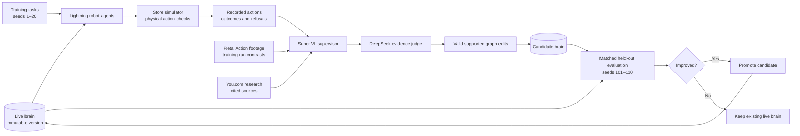
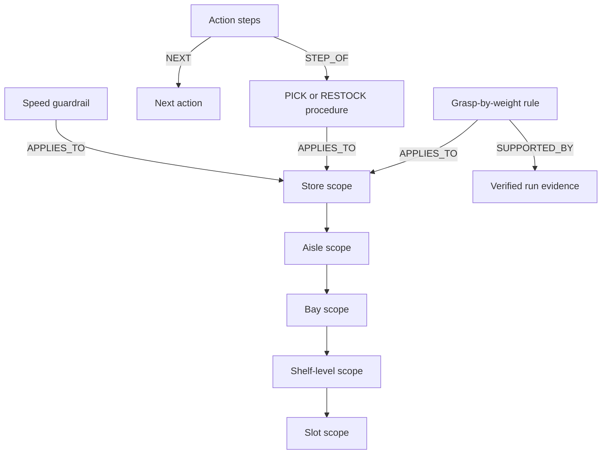
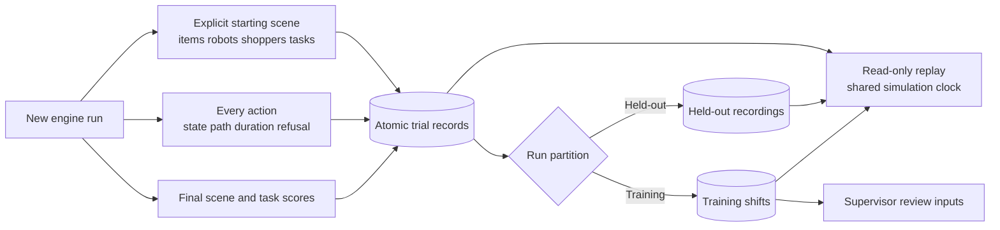
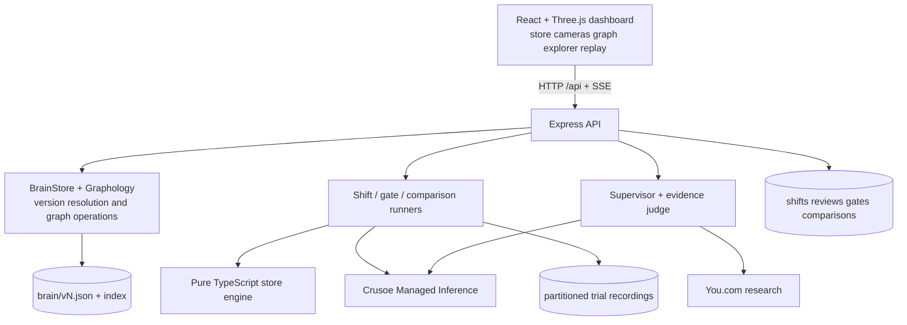

# AutoRoboHarness

**A shared brain for a fleet of store robots, with evidence for every improvement.**

AutoRoboHarness is a simulated convenience store where up to four robots pick products and restock shelves. Crusoe-hosted agents choose real simulator actions, a supervisor investigates their failures, and an independent judge checks the proposed lessons. A new brain earns deployment through a controlled evaluation.

The dashboard makes that process inspectable: browse every saved knowledge graph, compare versions, run historical brains without changing the live brain, and replay recorded trials through each robot's head camera.

Built at the Recursive Agents Hackathon, Crusoe × Cerebral Valley, October 17, 2026. Version 2 is complete; Version 3 is in progress and not part of this dashboard.

## The learning loop



Failures come from the world. The engine refuses actions such as reaching above the torso, moving with an extended arm, or lifting a product beyond the selected grasp's payload limit. Those refusals and their reasons become evidence; they are not scripted demonstrations.

A successful task means the intended item reaches its target **with zero refused actions**. Delivering an item after a recovery still counts as a failed task under this strict metric. The promotion rule accepts higher completion, or equal completion with fewer refusals.

## What to open

The dashboard has three tabs. Live trials and saved results both follow the same three stages: **1 Launch** (robots, tasks, seed, brain), **2 Robots at work** (3D store or robot head cameras, per-robot action logs, the knowledge graph pulsing the nodes each action read) and **3 Review** (failures linked to their exact step, grounded insights, brain updates in plain English with their graph operations, and Update Brain with before/after graphs and the gate).

| Tab | Address | What it does |
| --- | --- | --- |
| Live trial | [localhost:5173/#live](http://127.0.0.1:5173/#live) | Launch a training shift (1–4 robots, a task per robot, a training seed, any saved brain) or a matched comparison of two brains. Makes Crusoe model calls. A local Motion preview makes none. |
| Previous results | [localhost:5173/#results](http://127.0.0.1:5173/#results) | Step through saved training runs, comparisons, the original gate and every recording: saved configuration, **Replay saved trial** with controls, and the recorded review. Read-only; it never calls a model or starts a review. Brain versions and full graph differences are a drilldown here. |
| Development | [localhost:5173/#development](http://127.0.0.1:5173/#development) | What Version 1 and Version 2 implemented and measured, and what Version 3 plans. Models and Crusoe console links. |

Older links still work: `#shift` opens Live trial, `#trials` opens Previous results and `#brains` opens its brain-version drilldown.

Runs saved before full recordings existed show their actual action logs and saved review, but no 3D replay; their starting scene was never saved, so it is not reconstructed. Version 3 buttons stay disabled.

## The verified improvement, and its limits

The original verified Version 2 gate, **`gate-mvcynupn`**, ran ten held-out tasks for each brain with Lightning workers:

| Metric | v4 | v5 |
| --- | ---: | ---: |
| Successful tasks | 6/10 | 9/10 |
| Success rate | 60% | 90% |
| Refused actions per task | 0.5 | 0.2 |
| Steps per task | 7.5 | 7.2 |

That evaluation used **150 successful model responses and zero local response replays**. The accepted update taught the brain to use a two-handed grasp for items above 2 kg. The simulator enforces 2 kg for one hand and 4 kg for two hands.

The [original gate record](AUTO-ROBO-SIM-FILES/verification/version-2-gate.json), [verification packet](AUTO-ROBO-SIM-FILES/verification/version-2-verification.json), and [review UI export](AUTO-ROBO-SIM-FILES/verification/version-2-ui.pdf) preserve the result and its evidence.

**The original gate saved scores, not full trajectories. It has no replay.** New matched comparisons record their own trajectories and show their actual results under separate evaluation IDs. Their aggregate includes the entire requested comparison, including failures and unavailable tasks; selecting example clips never changes the denominator. Incomplete runs remain labeled incomplete. A fresh model run may produce different results, and a later brain can perform worse.

The earlier Version 1 gate used another task specification and measured 40% versus 40%, with fewer refusals after the update. It is a separate experiment. History connects measurements only within the same evaluation; different task sets do not form one improvement curve.

### Fresh recorded comparison

A separate Lightning run, **`cmp-mvd0u3kl-2`**, completed all **20/20 trials** and saved **144 physical action records**. It measured **v4: 6/10 (60%)** and **v5: 9/10 (90%)**, with **147 model responses and zero local response replays**. Refusals per task were **0.5 → 0.1**, and steps per task were **7.5 → 6.9**.

This fresh run used the same requested PICK task and ten held-out seeds, and happened to reproduce the original success percentages. It remains a separate experiment. Its [complete result](AUTO-ROBO-SIM-FILES/verification/version-2-fresh-comparison.json) includes every task outcome; its saved recordings can be opened under **Previous results**. The original gate still has no replay. [The explorer verification](AUTO-ROBO-SIM-FILES/verification/version-2-explorer-verification.json) records unchanged brain/evidence hashes, restart durability and the zero-inference replay audit.

## How the brain works

Each saved version is a complete JSON knowledge graph. A scope tree lets a worker retrieve knowledge for its task's shelf slot and its ancestors. Procedures specify action order; rules fill parameters; protocols handle conditions; guardrails constrain behavior; evidence records why a lesson exists.

For a quick demo, open **Previous results → Explore → Brain versions** ([direct link](http://127.0.0.1:5173/#results?view=brains)). The evolution map shows every saved version together, with actual parent connections and rejected branches. The current v1→v4→v5 ancestry adds torso positioning, then weight-based grasping: eight knowledge nodes and ten links in total. The graph colors additions by version; zoom, inspect a node, or expand the complete graph. Evaluation records and the detailed two-version comparison remain available below the map. Those scores retain their individual evaluation IDs and task sets.



The diagram shows the concepts; the explorer displays the actual saved nodes, directed edges and properties. Retired knowledge stays visible in its snapshot. Saved files outside the live index appear as unregistered; missing or unreadable snapshots are labeled unavailable. Browsing never repairs or rewrites them. Version files are immutable; promotion changes which version the index marks live. Selecting an earlier version for a shift or comparison never promotes it or edits a snapshot.

## Recording, replay and evaluation isolation



New shifts, gate runs and historical comparisons persist an explicit starting world and their complete action trajectories. Recordings include robot states, item locations, shopper positions, movement paths, action durations, refusals and outcomes. Writes happen at creation, after each action and at completion. A server restart preserves saved playback and marks unfinished recordings interrupted; it does not silently resume inference.

Held-out recordings live separately from training shifts. They can be viewed by the dashboard but are excluded from supervisor review, sibling-run search and training inputs. This is application-level isolation; the optional OpenShell supervisor integration was dropped and is not claimed as a security boundary.

Matched comparisons use the same seed, actual task specifications, robot count, starting-world hash and effective environment for both brains. When a requested slot cannot supply the task, the runner records an equivalent slot or an explicit failed task. Every requested task remains in the aggregate denominator. Historical comparisons never apply graph edits or update the live index.

## Run locally

You need **Node.js 22.12 or newer** (`node -v`) and git.

```sh
git clone https://github.com/ShashwatM3/AutoRoboHarness.git
cd AutoRoboHarness
npm ci --prefix engine
npm ci --prefix server
npm ci --prefix web
cp .env.example .env
```

Fill in `.env` locally (it is git-ignored; the browser never receives it):

- `CRUSOE_API_KEY` (**required** for live trials, reviews and gates): a Crusoe Managed Inference key.
- `CRUSOE_BASE_URL`: defaults to `https://api.inference.crusoecloud.com/v1`.
- `YDC_API_KEY` (optional): You.com key for the supervisor's research citations. `YDC_API_KEY_2` is an optional second key.
- `LLM_RPM`, `LLM_CONCURRENCY`, `LLM_429_WAIT_S`: pacing, defaulting to 18 starts/minute, 4 in flight and 600 seconds of 429 recovery.

Start the API in one terminal and the dashboard in a second:

```sh
npm start --prefix server      # API on http://127.0.0.1:8787
npm run dev --prefix web       # dashboard on http://127.0.0.1:5173
```

Open [http://127.0.0.1:5173](http://127.0.0.1:5173). For a first trial: **Live trial → Training shift**, keep two robots and seed 01, press **Launch shift**, watch stage 2, then press **Go to review** and **Start or open the review**. The review calls the Super VL supervisor and the DeepSeek judge on Crusoe (a saved example used 9 model calls); **Update Brain** runs a held-out gate of about 150 Lightning calls.

**What a fresh clone contains.** Only the checked-in seed brain (`brain/v1.json`) and the documented verification files. Generated brain versions, saved shifts, reviews, gates, comparisons and recordings are runtime data under `server/data/` (or the directory in `BRAIN_DIR` for brains) and are not in git, so Previous results starts empty until you run something.

**Without an API key.** The dashboard still opens. Live trial's Motion preview runs the real engine locally with no model calls, Development works, and Previous results shows whatever saved data exists. Launching a shift, a review or a gate needs the key.

**Replaying saved data.** If you have runtime data (your own runs, or a copy placed in `server/data/` with its brains in `BRAIN_DIR`), restart the API and open Previous results. Replay reads recordings only and makes zero model calls.

**Provider records.** Click **View this run’s recorded usage** for its saved response and token counts, model, timestamps and source record. The panel gives the correct model and a copyable UTC window for Crusoe. Its [project metrics page](https://console.crusoecloud.com/foundry/metrics) has independent filters and may open on another model; choose the indicated model, project and custom time range. Those charts aggregate project traffic, so they are not a per-run record. ([Metrics documentation](https://docs.crusoecloud.com/serverless-inference/inference-metrics/index.html).)

**Troubleshooting.**

- *Port in use:* another API or Vite is already running on 8787 or 5173. Stop it, or reuse it.
- *429 responses:* the Crusoe quota is shared by every machine using the same project. The server waits and retries for up to `LLM_429_WAIT_S`; run inference on one machine at a time.
- *After pulling code:* restart the API deliberately once active work finishes; a restart marks unfinished recordings interrupted and never resumes model calls.
- *"Server offline" in the header:* start the API first; Vite forwards `/api` and `/ground_truth` to port 8787.

## Architecture and models



| Role | Crusoe model |
| --- | --- |
| Robot workers | `nvidia/Nemotron-3.5-Lightning-30B-A3B` |
| Supervisor and visual evidence | `nvidia/NVIDIA-Nemotron-3.5-Super-VL` |
| Supervisor fallback | `nvidia/NVIDIA-Nemotron-3-Super-120B-A12B` |
| Independent evidence judge | `deepseek-ai/DeepSeek-V4-Pro` |

| Directory | Responsibility |
| --- | --- |
| [`engine/`](engine/README.md) | Deterministic store world, physical actions, trajectory facts and strict task scoring. No graphics or model dependencies. |
| [`server/`](server/README.md) | Brain graph, Crusoe workers, supervisor, judge, evaluation gates and persistent recordings. |
| [`web/`](web/) | Launch/review screens, Three.js store, robot cameras, graph explorer and saved replay. |
| [`brain/`](brain/) | Seed graph and locally generated immutable version snapshots. |
| [`ground_truth/`](ground_truth/NOTICE.md) | Licensed RetailAction evidence and attribution. |
| [`AUTO-ROBO-SIM-FILES/`](AUTO-ROBO-SIM-FILES/INDEX.md) | Design constraints, progress, build plans and original verification evidence. |

Useful read APIs include `/api/brain/versions`, `/api/brain?v=4`, `/api/brain/history`, `/api/evaluations`, `/api/trials`, `/api/trials/:id`, `/api/comparisons` and `/api/comparisons/:id`. New work starts through `POST /api/shift` or `POST /api/comparisons`; replay GETs never start a run.

## Checks

```sh
npm run typecheck --prefix engine
npm test --prefix engine
npm run typecheck --prefix server
npm test --prefix server
npm run typecheck --prefix web
npm test --prefix web
npm run build --prefix web
```

The tests cover physical constraints, deterministic worlds, recorded-state restoration, graph differences, camera layouts, request pacing, judge enforcement, and trial/comparison persistence and isolation. The browser and actual server-restart checks are recorded in [SEQUENCE.md](AUTO-ROBO-SIM-FILES/SEQUENCE.md).

## Built during the event

The store engine, scenario generator, action checks, scoring, brain and agent integration, scene assembly, robot model, animations and dashboard are project code built during the event. React, Vite, TypeScript, Three.js, Graphology, Express and Lucide are dependencies.

Store furnishings, food and shopper meshes come from Kenney's CC0 Mini Market, Food Kit and Mini Characters packs. Their licenses are in [the asset notice](web/public/assets/NOTICE.md). RetailAction attribution and its Standard AI license are in [the footage notice](ground_truth/NOTICE.md).
