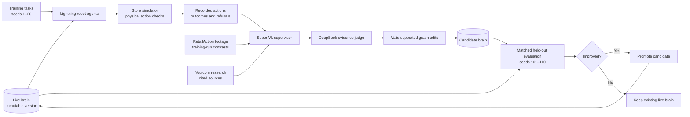
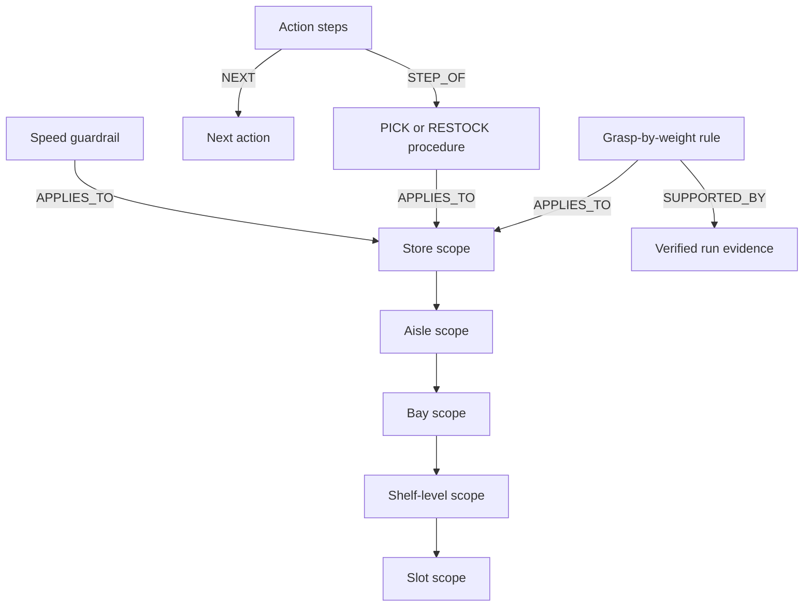
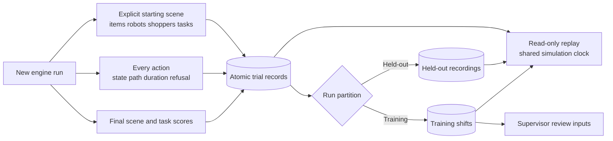
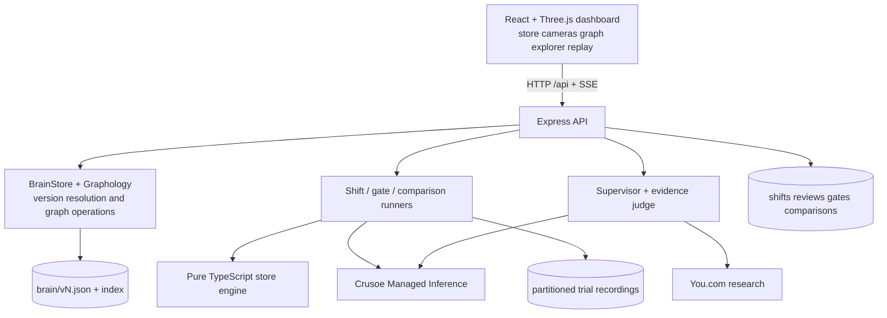

# AutoRoboHarness

**A shared brain for a fleet of store robots, with evidence for every improvement.**

AutoRoboHarness is a simulated convenience store where up to four robots pick products and restock shelves. Crusoe-hosted agents choose real simulator actions, a supervisor investigates their failures, and an independent judge checks the proposed lessons. A new brain earns deployment through a controlled evaluation.

The dashboard makes that process inspectable: browse every saved knowledge graph, compare versions, run historical brains without changing the live brain, and replay recorded trials through each robot's head camera.

Built at the Recursive Agents Hackathon, Crusoe × Cerebral Valley, October 17, 2026. The current work completes **Version 2**; Version 3 has not started.

## The learning loop



Failures come from the world. The engine refuses actions such as reaching above the torso, moving with an extended arm, or lifting a product beyond the selected grasp's payload limit. Those refusals and their reasons become evidence; they are not scripted demonstrations.

A successful task means the intended item reaches its target **with zero refused actions**. Delivering an item after a recovery still counts as a failed task under this strict metric. The promotion rule accepts higher completion, or equal completion with fewer refusals.

## What to open

Once the server and web app are running:

| Dashboard | Address | What it does |
| --- | --- | --- |
| Run a shift | [localhost:5173/#shift](http://127.0.0.1:5173/#shift) | Choose a brain, seed, one to four robots, and PICK or RESTOCK tasks. Watch the store or robot cameras. |
| Brain explorer | [localhost:5173/#brains](http://127.0.0.1:5173/#brains) | Browse saved versions, their parents, change reasons, evaluation IDs and task counts. Pan, zoom, search and inspect graphs side by side. |
| Trials and comparisons | [localhost:5173/#trials](http://127.0.0.1:5173/#trials) | Launch a matched historical comparison or replay saved trials without inference. The default comparison is v4 versus v5 when those snapshots are available. |

The graph supports scroll-to-zoom, drag-to-pan, node search, double-click-to-focus, neighbor highlighting, and node/edge inspection. Green, red and amber identify additions, removals and changes. The property comparison includes nested values, labels and node types. Missing evaluations say **“Not evaluated.”**

Replay offers play/pause, speed, backward/forward steps, a seekable timeline and synchronized comparison views. Each camera and action log identifies its brain version. Both recordings share elapsed simulation time; a finished recording holds its final scene while its partner continues.

**“Run new comparison” makes model calls. “Replay saved trial” reads recorded data only.** The separate Motion Preview is a local engine demonstration and does not represent an agent evaluation.

## The verified improvement, and its limits

The original verified Version 2 gate, **`gate-mvcynupn`**, ran ten held-out tasks for each brain with Lightning workers:

| Metric | v4 | v5 |
| --- | ---: | ---: |
| Successful tasks | 6/10 | 9/10 |
| Success rate | 60% | 90% |
| Refused actions per task | 0.5 | 0.2 |
| Steps per task | 7.5 | 7.2 |

That evaluation used **150 successful model responses and zero local response replays**. The accepted update taught the brain to use a two-handed grasp for items above 2 kg. The simulator enforces 2 kg for one hand and 4 kg for two hands.

The [original gate record](AUTO-ROBO-SIM-FILES/verification/version-2-gate.json), [verification packet](AUTO-ROBO-SIM-FILES/verification/version-2-verification.json), and [review UI export](AUTO-ROBO-SIM-FILES/verification/version-2-ui.pdf) preserve the result and its evidence.

**The original gate saved scores, not full trajectories. It has no replay.** New matched comparisons record their own trajectories and show their actual results under separate evaluation IDs. Their aggregate includes the entire requested comparison, including failures and unavailable tasks; selecting example clips never changes the denominator. Incomplete runs remain labeled incomplete. A fresh model run may produce different results, and a later brain can perform worse.

The earlier Version 1 gate used another task specification and measured 40% versus 40%, with fewer refusals after the update. It is a separate experiment. History connects measurements only within the same evaluation; different task sets do not form one improvement curve.

### Fresh recorded comparison

A separate Lightning run, **`cmp-mvd0u3kl-2`**, completed all **20/20 trials** and saved **144 physical action records**. It measured **v4: 6/10 (60%)** and **v5: 9/10 (90%)**, with **147 model responses and zero local response replays**. Refusals per task were **0.5 → 0.1**, and steps per task were **7.5 → 6.9**.

This fresh run used the same requested PICK task and ten held-out seeds, and happened to reproduce the original success percentages. It remains a separate experiment. Its [complete result](AUTO-ROBO-SIM-FILES/verification/version-2-fresh-comparison.json) includes every task outcome; its saved recordings can be opened under **Saved trials & comparisons**. The original gate still has no replay. [The explorer verification](AUTO-ROBO-SIM-FILES/verification/version-2-explorer-verification.json) records unchanged brain/evidence hashes, restart durability and the zero-inference replay audit.

## How the brain works

Each saved version is a complete JSON knowledge graph. A scope tree lets a worker retrieve knowledge for its task's shelf slot and its ancestors. Procedures specify action order; rules fill parameters; protocols handle conditions; guardrails constrain behavior; evidence records why a lesson exists.



The diagram shows the concepts; the explorer displays the actual saved nodes, directed edges and properties. Retired knowledge stays visible in its snapshot. Saved files outside the live index appear as unregistered; missing or unreadable snapshots are labeled unavailable. Browsing never repairs or rewrites them. Version files are immutable; promotion changes which version the index marks live. Selecting an earlier version for a shift or comparison never promotes it or edits a snapshot.

## Recording, replay and evaluation isolation



New shifts, gate runs and historical comparisons persist an explicit starting world and their complete action trajectories. Recordings include robot states, item locations, shopper positions, movement paths, action durations, refusals and outcomes. Writes happen at creation, after each action and at completion. A server restart preserves saved playback and marks unfinished recordings interrupted; it does not silently resume inference.

Held-out recordings live separately from training shifts. They can be viewed by the dashboard but are excluded from supervisor review, sibling-run search and training inputs. This is application-level isolation; the optional OpenShell supervisor integration was dropped and is not claimed as a security boundary.

Matched comparisons use the same seed, actual task specifications, robot count, starting-world hash and effective environment for both brains. When a requested slot cannot supply the task, the runner records an equivalent slot or an explicit failed task. Every requested task remains in the aggregate denominator. Historical comparisons never apply graph edits or update the live index.

## Run locally

Node.js **22.12 or newer** is required. The engine, server and web app each have a lockfile.

```sh
git clone https://github.com/ShashwatM3/AutoRoboHarness.git
cd AutoRoboHarness
npm ci --prefix engine
npm ci --prefix server
npm ci --prefix web
cp .env.example .env
```

Fill in `.env` locally:

- `CRUSOE_API_KEY`: Crusoe Managed Inference key.
- `CRUSOE_BASE_URL`: defaults to `https://api.inference.crusoecloud.com/v1`.
- `YDC_API_KEY`: You.com key for supervisor research. `YDC_API_KEY_2` is an optional second key.
- `LLM_RPM`, `LLM_CONCURRENCY`, `LLM_429_WAIT_S`: request pacing and recovery, defaulting to 18 starts/minute, concurrency 4, and 600 seconds of 429 recovery.

Credentials stay in the git-ignored `.env`; the browser never receives them. The optional [Crusoe Cloud MCP setup guide](AUTO-ROBO-SIM-FILES/CRUSOE-MCP-SETUP.md) explains infrastructure access. The application itself uses Crusoe's inference API.

Start the backend in one terminal:

```sh
npm start --prefix server
```

Start the dashboard in another:

```sh
npm run dev --prefix web
```

The API listens on port **8787** and the dashboard on **5173**. Vite forwards `/api` and `/ground_truth` to the backend. Use `npm start` for long evaluations; restart the server deliberately after code changes, once active work finishes. Watch mode is available as `npm run dev --prefix server` for ordinary development.

A fresh checkout starts with the checked-in seed brain. The explorer lists the snapshots actually available in `brain/`, or the directory selected by `BRAIN_DIR`. Saved local trials, generated versions, response caches and live-index state are runtime data; they are not downloaded by `npm ci`. Original verification records remain available in the documentation even when a local snapshot or replay is absent.

Crusoe quota is shared across machines using the same project. Run inference on one machine at a time. The scheduler honors a shared per-model cooldown and retries 429 responses for up to `LLM_429_WAIT_S`; simultaneous clients can still compete for quota. Provider cache usage appears only when reported. Local response-cache replays are counted separately and never presented as Crusoe cache hits.

## Architecture and models



| Role | Crusoe model |
| --- | --- |
| Robot workers | `nvidia/Nemotron-3.5-Lightning-30B-A3B` |
| Supervisor and visual evidence | `nvidia/NVIDIA-Nemotron-3.5-Super-VL` |
| Supervisor fallback | `nvidia/NVIDIA-Nemotron-3-Super-120B-A12B` |
| Independent evidence judge | `deepseek-ai/DeepSeek-V4-Pro` |

| Directory | Responsibility |
| --- | --- |
| [`engine/`](engine/README.md) | Deterministic store world, physical actions, trajectory facts and strict task scoring. No graphics or model dependencies. |
| [`server/`](server/README.md) | Brain graph, Crusoe workers, supervisor, judge, evaluation gates and persistent recordings. |
| [`web/`](web/) | Launch/review screens, Three.js store, robot cameras, graph explorer and saved replay. |
| [`brain/`](brain/) | Seed graph and locally generated immutable version snapshots. |
| [`ground_truth/`](ground_truth/NOTICE.md) | Licensed RetailAction evidence and attribution. |
| [`AUTO-ROBO-SIM-FILES/`](AUTO-ROBO-SIM-FILES/INDEX.md) | Design constraints, progress, build plans and original verification evidence. |

Useful read APIs include `/api/brain/versions`, `/api/brain?v=4`, `/api/brain/history`, `/api/evaluations`, `/api/trials`, `/api/trials/:id`, `/api/comparisons` and `/api/comparisons/:id`. New work starts through `POST /api/shift` or `POST /api/comparisons`; replay GETs never start a run.

## Checks

```sh
npm run typecheck --prefix engine
npm test --prefix engine
npm run typecheck --prefix server
npm test --prefix server
npm run typecheck --prefix web
npm test --prefix web
npm run build --prefix web
```

The tests cover physical constraints, deterministic worlds, recorded-state restoration, graph differences, camera layouts, request pacing, judge enforcement, and trial/comparison persistence and isolation. The browser and actual server-restart checks are recorded in [SEQUENCE.md](AUTO-ROBO-SIM-FILES/SEQUENCE.md).

## Built during the event

The store engine, scenario generator, action checks, scoring, brain and agent integration, scene assembly, robot model, animations and dashboard are project code built during the event. React, Vite, TypeScript, Three.js, Graphology, Express and Lucide are dependencies.

Store furnishings, food and shopper meshes come from Kenney's CC0 Mini Market, Food Kit and Mini Characters packs. Their licenses are in [the asset notice](web/public/assets/NOTICE.md). RetailAction attribution and its Standard AI license are in [the footage notice](ground_truth/NOTICE.md).
