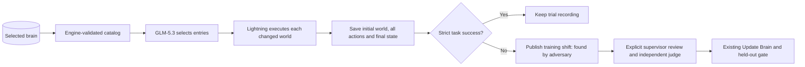

# Training adversary

The adversary probes a frozen brain snapshot using bounded, reproducible changes to a training world. It never changes that brain, the live index, a saved scene or the held-out evaluation set.

## Endpoints

All routes work under `/api` as well as at the server root.

- `POST /adversary`: starts a job, returns HTTP 202 and its durable record. Body fields are optional: `shift_id` selects an existing training shift's seed and first task; `seed` defaults to 1; `task` defaults to `{"type":"PICK","slot":"A-1-3-1"}`; `brain` defaults to `"live"`; `attempts` defaults to the catalog size, at most four; `worker` defaults to `"llm"`; `proposer` defaults to `"llm"`.
- `GET /adversary`: `{ runs: [...] }`, newest first.
- `GET /adversary/:id`: saved status, actual counts, proposal response ID and selection, attempts and linked trial IDs. This never runs a model or starts a review.
- `POST /adversary/:id/review` with `{ "shift_id": "<failed attempt's training shift>" }`: explicitly starts the existing supervisor workflow. Only completed failures belonging to this attack are accepted.

`worker: "compiled", proposer: "catalog"` executes an offline catalog sweep. Its results are labeled compiled policy results, not model evaluations. In LLM mode the proposer is `zai-org/GLM-5.3`, configurable with `ADVERSARY_MODEL`; the workers use the existing Lightning model and quota scheduler.

The model chooses catalog indices and rationales. It cannot introduce arbitrary actions, item weights or layout edits. Malformed output, invalid indices and repeated choices fail the job; no fabricated scenario or fallback model decision is substituted.

## Physical limits

`engine/disturbances.ts` exports `applyDisturbance(scenario, kind, params)`, which returns a modified **copy** of a world before execution.

| Kind | Parameters | Engine behavior |
| --- | --- | --- |
| `blocked_aisle` | `from`, `to`: adjacent aisle waypoints | Removes the segment in both directions. Rejects a change without an alternate route. Navigation records the actual longer route. |
| `wrong_slot` | `item_id`, `target_slot` | Moves the real item to another shelf slot, swapping with its occupant when necessary. Preserves physical identities. |
| `heavy_top_shelf` | `item_id`, `target_slot`, `weight_kg` | Uses a level-four shelf and a weight above 2 kg and at most 4 kg. Moves the real item and preserves displaced stock. The order's requested source stays recorded, so displacement may also reveal a stock-location failure. |
| `behind_fresh` | `item_id`, `fresh_item_id` | Places the older item in an explicit `behind:<slot>` location with expiry day −1, and the fresh item in front with expiry day 7. The front item must be removed before the older one becomes visible to scan/grasp. Days are relative scenario metadata; there is no unsupported food-inspection action. |

Only training seeds 1–20 are permitted. A request for held-out seed 101–110 is rejected. The catalog preserves task type and records any seed-specific slot substitution. Every attempted execution gets its own initial-world hash and complete trial recording.

## Counts and persistence

`tried` counts completed world executions. `broke` counts completed executions with a failed strict task check. Model errors and interrupted runs appear separately and do not count as discovered robot failures. Success means delivery of the intended item with zero refused actions.

The job is atomically saved before work begins and after each state change. Trials save every action. Only completed failures become ordinary training shifts, with `source.kind: "adversary"`, the attack ID and disturbance details. The supervisor receives the actual disturbance as context and must ground its conclusions in recorded actions and evidence. Safe reporting can leave a delivery incomplete; the strict metric still records a failed task.

On restart a running attack becomes `interrupted`; it is never resumed automatically. Completed jobs and recordings remain readable. Adversary and post-training worker jobs share an exclusive inference lock with comparisons. The existing paced starts and ten-minute 429 recovery remain in effect. Browsing a saved attack does not claim the lock or call inference.

No attack automatically edits or promotes a brain. Any proposed lesson still uses the existing judge and controlled held-out gate. A later brain is not assumed to perform better.
